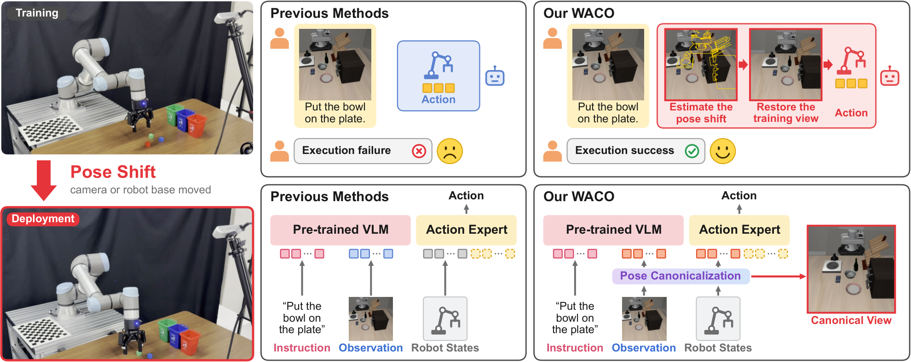
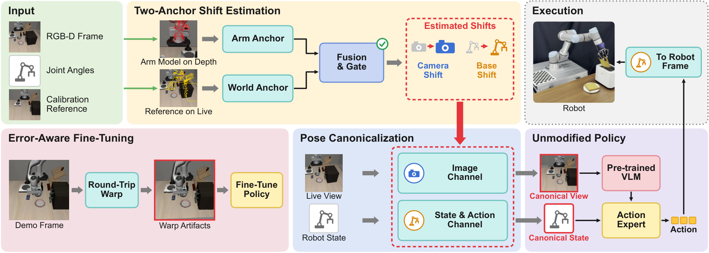

<div align="center">

# Towards Pose-Robust Few-Shot Vision-Language-Action Models

**WACO: World-Anchored Canonicalization** &nbsp;·&nbsp; **LIBERO-PoseShift benchmark**

[Wenhao Li](https://github.com/peacelwh)<sup>1,2</sup>, Xuening Zhang<sup>3</sup>, Yuhao Wei<sup>4,2</sup>, Zhongyi Han<sup>1</sup>, Pu Wang<sup>1,2</sup>, Yuze Wang<sup>3,2</sup>, Jingkai Wang<sup>5</sup>, Yilong Yin<sup>1</sup>

<sup>1</sup>Shandong University &nbsp; <sup>2</sup>Shenzhen Loop Area Institute &nbsp; <sup>3</sup>Harbin Institute of Technology, Shenzhen &nbsp; <sup>4</sup>Xidian University &nbsp; <sup>5</sup>Fudan University

[](https://peacelwh.github.io/WACO/)
[](https://peacelwh.github.io/WACO/static/pdf/WACO.pdf)
[](https://huggingface.co/Bluexxx/WACO-pi05-LIBERO)
[](https://huggingface.co/datasets/Bluexxx/LIBERO-PoseShift)
[](LICENSE)



</div>

A few-shot fine-tuned vision-language-action (VLA) model silently assumes that the camera and the robot base stay exactly where they were during data collection: a bumped tripod or a base re-docked a few centimetres away makes it reach for the wrong place. Both failures are one phenomenon, a change of the camera-to-base extrinsic that the policy has memorised, and the robot carries everything needed to undo it.

**WACO** is a world-anchored canonicalization framework for VLA models. The arm, placed by forward kinematics at the measured joint angles, serves as a metric calibration target, and the static scene serves as the world anchor that tells a moved camera from a moved robot. From a single RGB-D frame, WACO

1. **estimates both shifts** without ground-truth extrinsics or extra data (two-anchor estimator with a ground-truth-free consistency gate),
2. **canonicalises** the image to the calibration viewpoint and the state, action and start pose to the calibration base frame (channel-separated canonicaliser), and
3. **fine-tunes the unmodified policy** under the artefacts of its own estimator (error-aware fine-tuning).

The policy architecture is untouched: any π0.5 checkpoint can run the WACO front end without retraining.

We also release **LIBERO-PoseShift**, the first benchmark for RGB VLAs with graded camera, base and compound shifts and a base-frame protocol that is isomorphic to a real robot.

<div align="center"></div>

## Highlights

- On **LIBERO-PoseShift**, WACO reaches **87.2%** average shifted success, **13.2 points** above the standard few-shot recipe (74.0%) and within 1.5 points of its own ground-truth oracle; the margin grows with the level: 5.8, 8.7 and 25.0 points at L1, L2 and L3.
- On the **LIBERO-Plus camera track** (1,599 tasks), the WACO runtime alone lifts the public π0.5 checkpoint from 62.5% to 89.4% without retraining, and error-aware fine-tuning brings WACO to **93.7%** (92.4% over three evaluation seeds), with no perturbed training data.
- On a **real UR5e** (four tasks), WACO raises the average shifted success from 43.3% to **80.0%** (+36.7 points) and comes within 5.4 points of the ground-truth oracle.
- The advantage grows as demonstrations become scarcer: WACO with 10 demonstrations per task (82.4%) exceeds the standard recipe with 50 (74.0%).

## Repository structure

```
WACO/
├── README.md       project goal, how to run, data sources
├── data/           few-shot splits, LIBERO-Plus camera-track ids; calibration bundles and depth are downloaded here
├── src/            core code: the `poseshift` package (benchmark, estimator, canonicaliser, augmentation)
├── scripts/        training, evaluation, plotting and batch scripts that reproduce the paper
├── results/        tables and figures of the paper
└── tests/          minimal runnable tests (no simulator needed)
```

| `src/poseshift/` | Role |
| --- | --- |
| `perturb.py`, `libero_env.py`, `env_config.py` | LIBERO-PoseShift: deterministic camera / base / compound shifts, registered as `--env.type=libero_poseshift` |
| `frames.py` | base-frame protocol (state and actions anchored at the calibration base pose) |
| `estimator.py` | two-anchor shift estimation: arm anchor, world anchor, fusion, front end for wide viewpoint changes |
| `waco_runtime.py` | WACO runtime: estimation at reset, consistency gate, channel A (image) and channel B (state, action, start pose) |
| `warp.py` | forward splat and inverse warp between two pinhole cameras |
| `rt_aug.py` | error-aware fine-tuning: round-trip reprojection and structured state noise |
| `optim.py`, `plugin.py` | memory-lean full fine-tuning of π0.5 (ZeRO-1 optimiser state, frozen vocabulary embedding) and LeRobot registration |

## Installation

WACO builds on [LeRobot](https://github.com/huggingface/lerobot) 0.6.1 (Python 3.12, PyTorch 2.6) and registers itself as a plugin; LeRobot is not modified for evaluation.

```bash
git clone https://github.com/peacelwh/WACO.git && cd WACO
conda create -n waco python=3.12 -y && conda activate waco
pip install "lerobot[pi,libero]==0.6.1" opencv-python-headless
bash scripts/install_plugin.sh          # registers --env.type=libero_poseshift and the training options
bash scripts/download_assets.sh         # calibration bundles, few-shot splits, camera-track ids -> data/
python -m pytest tests                  # optional: 25 tests, no simulator needed
```

Headless rendering uses EGL (`MUJOCO_GL=egl`, set by the scripts). On its first import LIBERO asks where its files live; answer the prompt once, or point `LIBERO_CONFIG_PATH` to a folder that holds its `config.yaml`. Training additionally needs the micro-batch patch and the per-frame depth:

```bash
python scripts/apply_lerobot_microbatch.py     # one optimiser update per step with bounded activation memory
WITH_DEPTH=1 bash scripts/download_assets.sh   # per-frame metric depth for round-trip reprojection (8.4 GB)
```

The LIBERO-Plus camera track needs a second environment in which the LIBERO-Plus fork replaces `libero`; see `scripts/setup_liberoplus_env.sh`.

## Data and models

| Asset | Where | Used for |
| --- | --- | --- |
| LIBERO demonstrations (50 per task, one camera pose, one base pose) | [`lerobot/libero`](https://huggingface.co/datasets/lerobot/libero) | training (used without modification) |
| π0.5 base checkpoint / public π0.5 LIBERO checkpoint | [`lerobot/pi05_base`](https://huggingface.co/lerobot/pi05_base), [`lerobot/pi05_libero_finetuned`](https://huggingface.co/lerobot/pi05_libero_finetuned) | initialisation / sensitivity study and LIBERO-Plus |
| Calibration bundles, per-frame depth, few-shot splits, camera-track ids | [`Bluexxx/LIBERO-PoseShift`](https://huggingface.co/datasets/Bluexxx/LIBERO-PoseShift) | WACO runtime and error-aware fine-tuning |
| WACO checkpoint for the LIBERO-Plus camera track | [`Bluexxx/WACO-pi05-LIBERO`](https://huggingface.co/Bluexxx/WACO-pi05-LIBERO) | LIBERO-Plus (93.7% / 92.4%) |

A **calibration bundle** is recorded once per workspace: the camera-to-base extrinsic, the nominal base pose and one RGB-D frame of the *empty* workspace from the nominal camera. It is the only calibration WACO assumes; ground-truth poses, segmentation and simulator state are never read at test time. `scripts/build_calibration.py` rebuilds the bundles from the simulator.

## LIBERO-PoseShift

LIBERO-PoseShift extends LIBERO with a deterministic perturbation layer on its robosuite/MuJoCo environment, so that all methods see identical scenes.

- **Camera** shifts rotate and translate the third-person camera.
- **Base** shifts move the robot in the floor plane and rotate it about the vertical, leaving table, objects and third-person camera fixed.
- **Both** applies the two independently.

| Level | Camera translation | Camera rotation / axis | Base translation | Base yaw |
| --- | --- | --- | --- | --- |
| L1 | ≤ 2 cm | ± 3° | ≤ 2 cm | ± 3° |
| L2 | ≤ 5 cm | ± 5° | ≤ 5 cm | ± 8° |
| L3 | ≤ 10 cm | ± 10° | ≤ 10 cm | ± 15° |

State and actions follow a **base-frame protocol** anchored at the calibration pose, in which a moved robot reports the pose it *believes* it has, exactly as hardware does; in the clean condition it coincides with the original data, so no training data has to be converted. The main grid is LIBERO-Spatial and LIBERO-10 × 10 tasks × 10 conditions (clean plus three kinds at three levels) × 10 episodes, 2,000 episodes per model.

```bash
# any LeRobot policy, one cell of the grid
lerobot-eval --policy.path=lerobot/pi05_libero_finetuned \
  --env.type=libero_poseshift --env.task=libero_spatial \
  --env.perturb_kind=both --env.perturb_level=l3 \
  --env.canon=waco \
  --eval.n_episodes=10 --eval.batch_size=10
```

`--env.canon=waco` enables the WACO runtime, `--env.oracle_canon=both` the ground-truth oracle, and `--env.action_frame=world` LIBERO's native world-frame convention.

## Evaluation

```bash
# the whole grid for one policy (resumable; results in outputs/eval/<TAG>/summary.md)
POLICY=/path/to/pretrained_model TAG=waco CANON=waco GPUS=0,1 bash scripts/eval_grid.sh

# LIBERO-Plus camera track with the released checkpoint (released prompts, evaluation seed 0)
POLICY=Bluexxx/WACO-pi05-LIBERO TAG=lp_waco CANON=waco PROMPT=released SEED=0 \
  bash scripts/eval_liberoplus_camera.sh
```

## Training

All learned policies are fine-tuned from the public π0.5 base checkpoint with LeRobot on the same demonstrations for the same number of steps: all weights, vocabulary embedding frozen, bf16, global batch 32, AdamW with learning rate 2.5e-5, 1k warm-up steps and cosine decay to 2.5e-6, 10k steps.

```bash
RUN=b1 bash scripts/train_pi05.sh                       # B1: the official few-shot recipe
RUN=w1 POSESHIFT_RT_AUG=1 bash scripts/train_pi05.sh    # W1: + error-aware fine-tuning (WACO = W1 + runtime)
```

The error-aware augmentation is applied inside the dataset with p_rt = p_s = 0.5: a training frame is splatted to a random virtual camera (up to 12 cm and 12° per axis) and back with a shift perturbed by the estimator's error model (8 mm and 0.6°), and the state receives a planar base-shift error (8 mm and 0.6°); action labels are unchanged.

## Reproducing the paper

| Paper | Command |
| --- | --- |
| Policies (B1, B1 + 2D aug, W1, few-shot, training ablations, LIBERO-Plus fine-tuning) | `bash scripts/reproduce_training.sh b1\|b1_aug\|w1\|fewshot\|ablation\|liberoplus` |
| Sensitivity and oracle bound (public checkpoint) | `bash scripts/reproduce_poseshift.sh sensitivity` |
| Pose-shift robustness on LIBERO-PoseShift (main comparison) | `bash scripts/reproduce_poseshift.sh main` |
| Ablations | `bash scripts/reproduce_poseshift.sh ablation` |
| Few-shot scaling | `bash scripts/reproduce_poseshift.sh fewshot` |
| Sensitivity to calibration error | `bash scripts/reproduce_poseshift.sh calib_error` |
| LIBERO-Plus camera track | `bash scripts/reproduce_liberoplus.sh public\|runtime\|waco` |
| Estimator accuracy and gate behaviour | `SUITE=libero_spatial TASKS=0,3,6 N_EP=2 python scripts/probe_estimator.py` |
| Feasibility of the base shifts | `python scripts/scan_base_feasibility.py` |

## Results

All numbers are success rates in % as reported in the paper; every table is in [`results/`](results/README.md).

**Pose-shift robustness on LIBERO-PoseShift** (LIBERO-Spatial and LIBERO-10, 200 episodes per cell, base-frame protocol; Avg is the mean over the nine shifted conditions).

| Method | Clean | Cam L1 | Cam L2 | Cam L3 | Base L1 | Base L2 | Base L3 | Both L1 | Both L2 | Both L3 | Avg |
| --- | --- | --- | --- | --- | --- | --- | --- | --- | --- | --- | --- |
| B1 (official few-shot recipe) | 84.5 | 82.0 | 83.5 | 67.5 | 84.5 | 80.0 | 63.0 | 87.5 | 73.5 | 44.5 | 74.0 |
| B1 + 2D aug (crop, rotate) | 86.5 | 87.0 | 83.0 | 75.0 | 87.5 | 82.5 | 66.5 | 84.0 | 79.0 | 53.0 | 77.5 |
| B2 (W1 data, no runtime) | 88.5 | 87.5 | 86.5 | 80.0 | 88.0 | 82.0 | 72.0 | 88.0 | 80.5 | 65.0 | 81.1 |
| Align-and-replay (B1 + front end, ch. B) | 86.0 | 82.5 | 80.0 | 65.5 | 86.5 | 90.0 | 83.0 | 86.0 | 77.0 | 63.0 | 79.3 |
| Base gauge (B1 + arm anchor only) | 86.5 | 85.0 | 80.5 | 64.0 | 87.5 | 74.0 | 56.0 | 82.5 | 73.0 | 46.0 | 72.1 |
| Camera gauge (B1 + arm anchor only) | 91.5 | 83.5 | 81.5 | 64.0 | 89.0 | 88.5 | 84.0 | 88.0 | 72.5 | 49.0 | 77.8 |
| WACO runtime on B1 | 88.0 | 88.5 | 83.5 | 73.5 | 84.5 | 87.0 | 86.5 | 86.5 | 77.0 | 66.0 | 81.4 |
| WACO runtime on B1 + 2D aug | 86.0 | 88.0 | 82.5 | 81.5 | 90.5 | 87.0 | 87.0 | 88.5 | 83.5 | 69.0 | 84.2 |
| **WACO** (W1 + runtime) | **87.0** | **91.0** | **87.0** | **84.5** | **89.5** | **89.5** | **86.5** | **91.0** | **86.5** | **79.0** | **87.2** |
| GT oracle on B1 † | 86.0 | 85.0 | 86.0 | 75.0 | 89.5 | 85.5 | 82.0 | 84.5 | 84.5 | 75.0 | 83.0 |
| GT oracle on W1 † | 89.0 | 89.5 | 88.5 | 86.5 | 90.0 | 91.0 | 86.5 | 91.0 | 87.5 | 87.5 | 88.7 |

† upper bound with ground-truth poses.

**LIBERO-Plus camera track** (1,599 tasks, one episode each). *Released*: the benchmark's prompts, which append the variant's parameters; *corrected*: the task's own instruction. Ours: evaluation seed 0 / mean over three evaluation seeds.

| Method | Perturbed data | Released | Corrected |
| --- | --- | --- | --- |
| π0.5 public checkpoint | – | 62.5 | 63.8 |
| + WACO runtime (no training) | – | 89.4 / 88.0 | 88.1 / 87.7 |
| **WACO** (error-aware fine-tuning + runtime) | – | **93.7 / 92.4** | **93.7 / 92.0** |

**Real robot** (UR5e with a Robotiq 2F-85 gripper, four tasks, 20 trials per task and condition; Avg is the mean over the three shifted conditions).

| Method | Nominal | Camera | Base | Both | Avg |
| --- | --- | --- | --- | --- | --- |
| π0.5 (B1) | 92.5 | 60.0 | 40.0 | 30.0 | 43.3 |
| B1 + 2D aug | 93.8 | 72.5 | 42.5 | 32.5 | 49.2 |
| WACO runtime on B1 | 91.3 | 75.0 | 72.5 | 62.5 | 70.0 |
| **WACO** (W1 + runtime) | **95.0** | **85.0** | **80.0** | **75.0** | **80.0** |
| GT oracle on W1 † | 95.0 | 87.5 | 86.3 | 82.5 | 85.4 |

## Citation

```bibtex
@article{li2026waco,
  title   = {Towards Pose-Robust Few-Shot Vision-Language-Action Models},
  author  = {Li, Wenhao and Zhang, Xuening and Wei, Yuhao and Han, Zhongyi and Wang, Pu and Wang, Yuze and Wang, Jingkai and Yin, Yilong},
  journal = {arXiv preprint},
  year    = {2026}
}
```

## License and acknowledgements

The code is released under the [Apache License 2.0](LICENSE). The released checkpoint is a fine-tune of π0.5 and follows the license of its base model. This project builds on [LeRobot](https://github.com/huggingface/lerobot), [openpi](https://github.com/Physical-Intelligence/openpi) (π0.5), [LIBERO](https://github.com/Lifelong-Robot-Learning/LIBERO), [LIBERO-Plus](https://github.com/sylvestf/LIBERO-plus) and [Depth Anything V2](https://github.com/DepthAnything/Depth-Anything-V2); we thank their authors.
