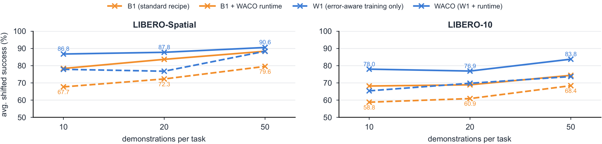

# Results

Tables and figures of the paper *Towards Pose-Robust Few-Shot Vision-Language-Action Models*.
All numbers are success rates in % as reported in the paper; machine-readable copies are in
[`tables/`](tables) and the figures in [`figures/`](figures). Evaluation scripts write their own
outputs to `outputs/eval/<tag>/summary.md` (per-cell success with Wilson 95% intervals).

## Sensitivity and oracle bound

The public pi0.5 checkpoint on LIBERO-Spatial and LIBERO-10 (200 episodes per cell; cells are
L1 / L2 / L3; base-frame protocol unless noted). The WACO runtime is applied without retraining.
\*World-frame average over base and compound rows only, since a camera shift is protocol-independent.

| Kind | None | World-frame protocol | WACO runtime | GT oracle |
| --- | --- | --- | --- | --- |
| clean | 96.0 | - | 97.5 | - |
| camera | 96.0 / 97.0 / 82.5 | - | 97.5 / 94.5 / 86.0 | 96.5 / 97.0 / 92.5 |
| base | 97.0 / 92.0 / 74.0 | 94.0 / 97.0 / 85.5 | 95.5 / 94.5 / 91.0 | 95.5 / 94.0 / 91.0 |
| both | 95.5 / 89.0 / 60.5 | 94.5 / 92.0 / 73.0 | 95.5 / 90.5 / 80.5 | 96.5 / 93.5 / 89.5 |
| Avg over shifts | 87.1 | 89.3* | 91.7 | 94.0 |

## Pose-shift robustness on LIBERO-PoseShift

LIBERO-Spatial and LIBERO-10, 200 episodes per cell, base-frame protocol. All learned rows share
checkpoint, demonstrations and budget; *est.*: shift estimated at test time; *GT*: upper bound with
ground-truth poses. Base / camera gauge: the arm's pose change read as a camera / base shift.
Avg is the mean over the nine shifted conditions.

| Method | Runtime | Clean | Cam L1 | Cam L2 | Cam L3 | Base L1 | Base L2 | Base L3 | Both L1 | Both L2 | Both L3 | Avg |
| --- | --- | --- | --- | --- | --- | --- | --- | --- | --- | --- | --- | --- |
| B1 (official few-shot recipe) | - | 84.5 | 82.0 | 83.5 | 67.5 | 84.5 | 80.0 | 63.0 | 87.5 | 73.5 | 44.5 | 74.0 |
| B1 + 2D aug (crop, rotate) | - | 86.5 | 87.0 | 83.0 | 75.0 | 87.5 | 82.5 | 66.5 | 84.0 | 79.0 | 53.0 | 77.5 |
| B2 (W1 data, no runtime) | - | 88.5 | 87.5 | 86.5 | 80.0 | 88.0 | 82.0 | 72.0 | 88.0 | 80.5 | 65.0 | 81.1 |
| Align-and-replay (B1 + front end, ch. B) | est. | 86.0 | 82.5 | 80.0 | 65.5 | 86.5 | 90.0 | 83.0 | 86.0 | 77.0 | 63.0 | 79.3 |
| Base gauge (B1 + arm anchor only) | est. | 86.5 | 85.0 | 80.5 | 64.0 | 87.5 | 74.0 | 56.0 | 82.5 | 73.0 | 46.0 | 72.1 |
| Camera gauge (B1 + arm anchor only) | est. | 91.5 | 83.5 | 81.5 | 64.0 | 89.0 | 88.5 | 84.0 | 88.0 | 72.5 | 49.0 | 77.8 |
| WACO runtime on B1 | est. | 88.0 | 88.5 | 83.5 | 73.5 | 84.5 | 87.0 | 86.5 | 86.5 | 77.0 | 66.0 | 81.4 |
| WACO runtime on B1 + 2D aug | est. | 86.0 | 88.0 | 82.5 | 81.5 | 90.5 | 87.0 | 87.0 | 88.5 | 83.5 | 69.0 | 84.2 |
| **WACO (W1 + runtime)** | **est.** | **87.0** | **91.0** | **87.0** | **84.5** | **89.5** | **89.5** | **86.5** | **91.0** | **86.5** | **79.0** | **87.2** |
| GT oracle on B1 (upper bound) | GT | 86.0 | 85.0 | 86.0 | 75.0 | 89.5 | 85.5 | 82.0 | 84.5 | 84.5 | 75.0 | 83.0 |
| GT oracle on W1 (upper bound) | GT | 89.0 | 89.5 | 88.5 | 86.5 | 90.0 | 91.0 | 86.5 | 91.0 | 87.5 | 87.5 | 88.7 |

Per suite (average over the nine shifted conditions, 900 episodes per cell):

| Method | Spatial | LIBERO-10 | Mean |
| --- | --- | --- | --- |
| B1 | 79.6 | 68.4 | 74.0 |
| B1 + 2D aug | 83.6 | 71.4 | 77.5 |
| B2 | 88.4 | 73.7 | 81.1 |
| WACO runtime on B1 | 88.4 | 74.4 | 81.4 |
| **WACO** | **90.6** | **83.8** | **87.2** |
| GT oracle on W1 | 91.0 | 86.3 | 88.7 |

## LIBERO-Plus camera track

1,599 tasks, one episode each. *Released*: the benchmark's prompts, which append the variant's
parameters; *corrected*: the task's own instruction. Evaluation seed 0 / mean over three
evaluation seeds.

| Method | Perturbed data | Released | Corrected |
| --- | --- | --- | --- |
| pi0.5 public checkpoint | - | 62.5 | 63.8 |
| + WACO runtime (no training) | - | 89.4 / 88.0 | 88.1 / 87.7 |
| **WACO (error-aware fine-tuning + runtime)** | **-** | **93.7 / 92.4** | **93.7 / 92.0** |

## Real robot

UR5e with a Robotiq 2F-85 gripper, four tasks, 20 trials per task and condition, averaged over the
four tasks. Avg is the mean over the three shifted conditions.

| Method | Nominal | Camera | Base | Both | Avg |
| --- | --- | --- | --- | --- | --- |
| pi0.5 (B1) | 92.5 | 60.0 | 40.0 | 30.0 | 43.3 |
| B1 + 2D aug | 93.8 | 72.5 | 42.5 | 32.5 | 49.2 |
| WACO runtime on B1 | 91.3 | 75.0 | 72.5 | 62.5 | 70.0 |
| **WACO (W1 + runtime)** | **95.0** | **85.0** | **80.0** | **75.0** | **80.0** |
| GT oracle on W1 (upper bound) | 95.0 | 87.5 | 86.3 | 82.5 | 85.4 |

Per task:

| Method | Condition | Lemon to Basket | Color Matching | Toy on Shelf | Toast into Toaster | Mean |
| --- | --- | --- | --- | --- | --- | --- |
| pi0.5 (B1) | Nominal | 95 | 95 | 90 | 90 | 92.5 |
| pi0.5 (B1) | Camera | 80 | 65 | 50 | 45 | 60.0 |
| pi0.5 (B1) | Base | 60 | 45 | 30 | 25 | 40.0 |
| pi0.5 (B1) | Both | 50 | 35 | 20 | 15 | 30.0 |
| pi0.5 (B1) | Mean (shifted) | 63.3 | 48.3 | 33.3 | 28.3 | 43.3 |
| B1 + 2D aug | Nominal | 95 | 95 | 95 | 90 | 93.8 |
| B1 + 2D aug | Camera | 90 | 80 | 65 | 55 | 72.5 |
| B1 + 2D aug | Base | 65 | 50 | 30 | 25 | 42.5 |
| B1 + 2D aug | Both | 55 | 40 | 20 | 15 | 32.5 |
| B1 + 2D aug | Mean (shifted) | 70.0 | 56.7 | 38.3 | 31.7 | 49.2 |
| WACO runtime on B1 | Nominal | 95 | 90 | 90 | 90 | 91.3 |
| WACO runtime on B1 | Camera | 90 | 80 | 70 | 60 | 75.0 |
| WACO runtime on B1 | Base | 85 | 75 | 70 | 60 | 72.5 |
| WACO runtime on B1 | Both | 80 | 70 | 55 | 45 | 62.5 |
| WACO runtime on B1 | Mean (shifted) | 85.0 | 75.0 | 65.0 | 55.0 | 70.0 |
| WACO (W1 + runtime) | Nominal | 95 | 95 | 95 | 95 | 95.0 |
| WACO (W1 + runtime) | Camera | 95 | 90 | 85 | 70 | 85.0 |
| WACO (W1 + runtime) | Base | 90 | 85 | 80 | 65 | 80.0 |
| WACO (W1 + runtime) | Both | 85 | 80 | 75 | 60 | 75.0 |
| WACO (W1 + runtime) | Mean (shifted) | 90.0 | 85.0 | 80.0 | 65.0 | 80.0 |
| GT oracle on W1 (upper bound) | Nominal | 95 | 95 | 95 | 95 | 95.0 |
| GT oracle on W1 (upper bound) | Camera | 95 | 90 | 90 | 75 | 87.5 |
| GT oracle on W1 (upper bound) | Base | 95 | 90 | 85 | 75 | 86.3 |
| GT oracle on W1 (upper bound) | Both | 90 | 85 | 80 | 75 | 82.5 |
| GT oracle on W1 (upper bound) | Mean (shifted) | 93.3 | 88.3 | 85.0 | 75.0 | 85.4 |

Analysis on Toy on Shelf and Toast into Toaster (20 trials per task and condition, averaged over
the two tasks). *Gauges*: arm anchor only. *Few-shot*: the first 10 of 50 demonstrations per task.
*Occluded*: a box hides about a third of the static background.

| Block | Method | Camera | Base | Both | Avg |
| --- | --- | --- | --- | --- | --- |
| Gauges | Base gauge | 55 | 25 | 20 | 33.3 |
| Gauges | Camera gauge | 30 | 65 | 35 | 43.3 |
| Gauges | WACO | 77.5 | 72.5 | 67.5 | 72.5 |
| Few-shot (10 demos) | B1 | 45 | 25 | 15 | 28.3 |
| Few-shot (10 demos) | WACO | 72.5 | 67.5 | 62.5 | 67.5 |
| Occluded | WACO w/o gate | - | 40 | - | - |
| Occluded | WACO | - | 72.5 | - | - |

## Ablations

Each block changes one component of the full method on LIBERO-Spatial and LIBERO-10. Avg is the
mean over the nine shifted conditions.

| Block | Variant | Clean | Cam L3 | Base L3 | Avg |
| --- | --- | --- | --- | --- | --- |
| **-** | **WACO (full)** | **87.0** | **84.5** | **86.5** | **87.2** |
| Channels | A only (image) | 87.0 | 82.5 | 67.5 | 82.0 |
| Channels | B only (state, action) | 87.0 | 77.5 | 81.5 | 83.6 |
| Channels | B without homing | 87.0 | 77.5 | 78.5 | 81.7 |
| Anchors | arm only (dT_c = I) | 87.0 | 78.5 | 86.5 | 82.6 |
| Anchors | scene only (dT_b = I) | 87.0 | 84.0 | 66.5 | 81.7 |
| Anchors | no consistency gate | 87.0 | 77.5 | 84.0 | 84.5 |
| Training | runtime on B1 | 88.0 | 73.5 | 86.5 | 81.4 |
| Training | round-trip only | 86.5 | 80.0 | 86.5 | 86.4 |
| Training | state noise only | 88.0 | 68.0 | 83.5 | 80.3 |
| Depth | reference depth only | 87.0 | 78.0 | 83.5 | 85.9 |
| Depth | plane homography only | 87.0 | 84.0 | 86.5 | 86.4 |

## Few-shot scaling

Average shifted success (nine conditions) on LIBERO-Spatial and LIBERO-10 with the first 10, 20 or
all 50 demonstrations per task, same recipe and budget.

| Demonstrations per task | 10 | 20 | 50 |
| --- | --- | --- | --- |
| B1 (standard recipe) | 63.2 | 66.6 | 74.0 |
| B1 + WACO runtime | 73.3 | 76.3 | 81.4 |
| W1 (error-aware training only) | 71.7 | 73.3 | 81.1 |
| **WACO (W1 + runtime)** | **82.4** | **82.3** | **87.2** |
| gain of WACO over B1 | +19.2 | +15.7 | +13.2 |

## Estimator accuracy

Simulation, 240 resets (four suites, three tasks each, two episodes per condition): median /
90th-percentile error against the true shift. A catastrophic estimate exceeds 2 cm or 1.5 deg;
*caught* counts catastrophic estimates whose channel the gate disabled, *false* counts accurate
estimates of a real shift that it disabled.

| Condition | dT_c mm | dT_c deg | dT_b mm | dT_b deg | Gate caught | Gate false |
| --- | --- | --- | --- | --- | --- | --- |
| clean | 0.0 / 6.6 | 0.0 / 0.0 | 0.7 / 7.6 | 0.1 / 0.2 | 0/0 | 0 |
| camera L1-L3 | 0.8 / 14.5 | 0.0 / 0.3 | 1.7 / 18.5 | 0.2 / 1.0 | 3/13 | 1 |
| base L1-L3 | 0.0 / 3.9 | 0.0 / 0.0 | 2.9 / 10.6 | 0.1 / 0.3 | 4/4 | 0 |
| both L1-L3 | 0.8 / 17.2 | 0.0 / 1.0 | 4.8 / 25.0 | 0.2 / 2.5 | 16/24 | 8 |
| all | 0.3 / 10.7 | 0.0 / 0.2 | 2.4 / 19.0 | 0.1 / 1.2 | 23/41 | 9 |

Real robot, against hand-eye re-calibration (10 poses per condition, three arm configurations
each, 120 estimates). *Accepted*: share of estimates the gate applies.

| Condition | dT_c mm | dT_c deg | dT_b mm | dT_b deg | Accepted |
| --- | --- | --- | --- | --- | --- |
| nominal | 0.6 / 2.4 | 0.0 / 0.1 | 1.1 / 3.8 | 0.1 / 0.2 | 100% |
| camera shift | 3.4 / 11.8 | 0.4 / 1.2 | 4.2 / 14.5 | 0.5 / 1.6 | 86.7% |
| base shift | 1.9 / 5.7 | 0.2 / 0.4 | 3.6 / 10.2 | 0.3 / 0.9 | 96.7% |
| both | 4.7 / 16.5 | 0.7 / 1.8 | 5.5 / 19.8 | 0.8 / 2.1 | 83.3% |
| all | 2.8 / 11.2 | 0.3 / 0.9 | 3.8 / 13.7 | 0.4 / 1.2 | 91.7% |

## Perturbation levels of LIBERO-PoseShift

Camera translations are uniform in a ball and base translations in a disc, both between half and
the full radius; rotations are uniform per axis. Last column: displacement of a target object in the
256 x 256 third-person view for the largest translation / yaw.

| Level | Camera trans. | Camera rot. / axis | Base trans. | Base yaw | px (t / yaw) |
| --- | --- | --- | --- | --- | --- |
| L1 | <= 2 cm | +-3 deg | <= 2 cm | +-3 deg | 6 / 12 |
| L2 | <= 5 cm | +-5 deg | <= 5 cm | +-8 deg | 15 / 21 |
| L3 | <= 10 cm | +-10 deg | <= 10 cm | +-15 deg | 31 / 42 |

## Figures

| File | Content |
| --- | --- |
| `figures/teaser.png` | overview of the problem and of WACO |
| `figures/overview.png` | model pipeline |
| `figures/mod_estimator.png` | two-anchor shift estimation |
| `figures/mod_canon.png` | canonicalization and error-aware training |
| `figures/bench_grid.png`, `figures/bench_design.png` | LIBERO-PoseShift observations and shift distribution |
| `figures/res_fewshot.png` | few-shot scaling |
| `figures/res_realrobot.png` | real-robot per-task performance |
| `figures/res_curves.png` | sensitivity to calibration error |
| `figures/hw_setup.png`, `figures/hw_tasks.png` | UR5e setup and the four real-robot tasks |
